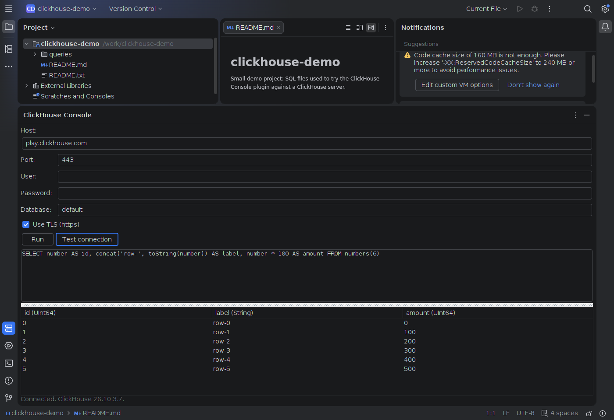
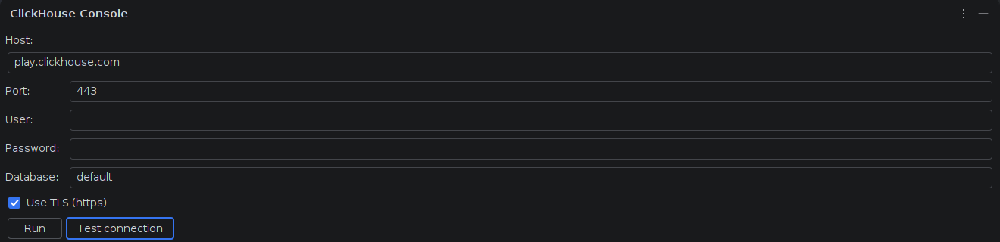
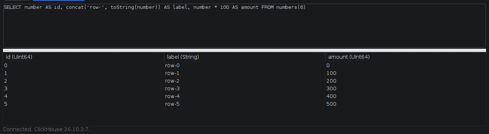
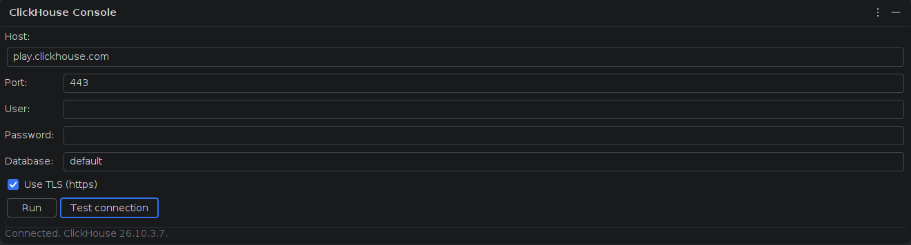

# ClickHouse Console

A JetBrains IDE plugin that runs [ClickHouse](https://clickhouse.com) queries and
shows the result as a table, using the **official HTTP interface** of the server.

- **Plugin id:** `com.tgglabs.clickhouseconsole`
- **Version:** 0.0.1 (first version, not published yet)
- **IDE:** IntelliJ Platform 2025.3 and later (`since-build 253`), any IDE —
  IDEA Community, PyCharm Community, WebStorm, GoLand…

## Screenshots

The pictures below are real captures of IntelliJ IDEA Community 2025.3 with
this plugin, running a query against the **public playground** of ClickHouse
(`play.clickhouse.com`, the official server of the ClickHouse project).









## What it does

- A **tool window** (`View | Tool Windows | ClickHouse Console`) with the
  connection parameters (host, port, user, password, database, TLS), a SQL
  editor and the result table.
- It talks to the server over the **official HTTP interface** of ClickHouse
  (port 8123 by default): the query is sent in the body of a `POST` request,
  the credentials with the `X-ClickHouse-User` / `X-ClickHouse-Key` headers,
  the format of the answer with the `default_format` parameter.
- The result is read from the `JSON` answer of the server: the column names
  and the column types are the ones the server sent, and a SQL `NULL` is shown
  as the explicit text `NULL`.
- The password is stored in the **PasswordSafe** of the IDE, never in the
  settings file of the IDE, and never in the code.

## What it does not do

- It does not modify the data of the server: it runs the query you write.
- It does not connect to a server over the native protocol (port 9000): the
  HTTP interface is the one it speaks.
- It does not send anything anywhere else: the query goes to the server you
  configured, and nowhere else.
- It has no account, no telemetry and no account creation.

## Build

The build needs a JDK 21 (the IntelliJ Platform 2025.3 is compiled for Java 21):

```bash
export JAVA_HOME=/path/to/jdk-21
./gradlew test buildPlugin
```

The ZIP of the plugin is then in `build/distributions/ClickHouseConsole-0.0.1.zip`.

The IntelliJ Platform itself (`com.jetbrains.intellij.idea:ideaIC:2025.3`) is
resolved from the JetBrains repository; pass `-PplatformLocalPath=/path/to/ide`
to compile against a local IDE installation instead (nothing is downloaded).

## Tests

```bash
./gradlew test
```

The tests are unit tests: the JSON parser, the parser of the answers of
ClickHouse (`JSON` and `TSV`), and the HTTP client, which is run against a
local server that plays the part of a ClickHouse server.

A test against the **public playground** of ClickHouse
(`play.clickhouse.com`) is included but is not run by the normal build; it
needs the network:

```bash
CLICKHOUSE_PUBLIC=1 ./gradlew test --tests '*ClickHousePublicServerTest*'
```

## Pre-flight check (IntelliJ Plugin Verifier)

`./gradlew verifyPlugin` runs the **IntelliJ Plugin Verifier** — the check the
JetBrains Marketplace runs before it accepts an upload. It resolves the IDE to
verify against from the JetBrains repositories; pass
`-PplatformLocalPath=/path/to/ide` to verify against an IDE you already have
installed (nothing is downloaded).

Measured on 13/11/2026:

```
Plugin com.tgglabs.clickhouseconsole:0.0.1 against IC-253.28294.334: Compatible.
Dynamic Plugin Eligibility:
    Plugin can probably be enabled or disabled without IDE restart
```

## License

MIT — see [LICENSE](LICENSE).
